# Architecture and data contracts

```mermaid
flowchart LR
  E[MicroEmulator desktop JVM] --> A[Byte Buddy probes + MicroEmulator adapters]
  A --> Q[Bounded runtime queue 8192]
  Q --> T[Authenticated loopback TCP / UMRA 1]
  T --> C[Backend collector + Zod validation]
  C --> B[Bounded ingestion queue 16384]
  B --> D[SQLite WASM in worker thread]
  D --> W[WebSocket batches + replay]
  W --> R[React bounded live store]
  R --> V[Virtualized events + observed call tree + inspectors]
```

Electron owns the backend lifecycle. Renderer has no Node, filesystem, process or database access. A sandboxed preload exposes only bootstrap config and constrained native file dialogs. HTTP controller owns process validation and lifecycle; the renderer cannot submit shell arguments. Child processes are launched with argument arrays and shell=false, and only owned session processes are stopped.

On launch the backend statically inspects the selected JAR using ASM, probes the selected Java executable, writes a per-session agent configuration and launches MicroEmulator with -javaagent. A bootstrap-only runtime JAR exposes hooks to the MIDlet loader. A narrow adapter makes MIDletClassLoader.classLoadByParent delegate umra.runtime.* to the parent. The original emulator preprocessor runs before Byte Buddy transforms loaded class bytes. No source, opcode or package of a specific game is hard-coded.

The runtime begins with capture disabled. Control commands flow on the authenticated local TCP connection. Start/Pause/Stop Trace success requires a matching RUNTIME_STATUS acknowledgement. The frontend displays emulator running only after instrumentation readiness. Start/Stop Trace do not restart or close the emulator.

Each observed call has a global string invocation ID, a thread-local observed parent and a trace ID. Input callbacks begin a trace context. An independently executing thread starts a separate root; the implementation deliberately does not infer queue/thread/task causality. Filtered modes retain the nearest observed ancestor, which is not necessarily a direct source-level call. The call graph API labels this observed-ancestry. Bytecode offsets are null; static instruction indices are explicitly labeled as indices.

Schema source of truth: shared-schemas/index.ts. Runtime lines are JSON objects limited to 64 KiB at ingestion. Snapshot encoding limits game values before they enter transport. Strings default to redacted, payload bytes default to disabled, stacks cap at 24 frames, arguments at 12, fields at 8, arrays at 8, byte previews at 512, runtime call depth at 64 and snapshot recursion/budget is bounded. Receiver snapshots are observations at method entry/exit, not proof that a particular write happened inside the invocation.

Runtime producer never performs disk or socket IO on a game thread. A daemon writer batches records; a daemon command reader changes capture state. Runtime overflow increments explicit dropped counters and emits TRACE_WARNING. The collector pauses TCP when its queue is high. Database operations run sequentially in a separate worker; inserts for a batch are transactional. The worker exports SQLite to a temporary file and atomically renames it every 1.5 seconds and at explicit flush/shutdown. This WASM SQLite persistence model has a last-flush recovery window and does not provide native WAL durability; large databases increase snapshot cost. A native SQLite worker is an appropriate future adapter for very large sessions.

WebSocket batches are emitted after the SQLite transaction is applied. Runtime and backend sequence numbers serve different purposes: runtimeSeq detects capture transport gaps; seq orders saved records in a session. The frontend keeps at most 10,000 events; the backend keeps a ring of 10,000 per session; history is queried from SQLite. WS has 4 KiB inbound messages, at most 8 clients, a 1 MiB buffered-output threshold and heartbeat/ping. Slow-client gaps are signaled; skipped live records remain in SQLite and are queryable. Reconnect replays a bounded 4,000 records and warns if a larger gap needs history/export.

Runtime memory is measured from java.lang.Runtime. CPU usage is unavailable rather than invented. Receipt latency is runtime wall-clock capture to backend wall-clock receipt on the same machine and includes the queue. Reports expose p50/p95 over at most 512 recent samples; these are measurements for a given run, not fixed guarantees.

Mapping entries are per-session display aliases with user notes. Original runtime names and observations remain intact. Deleting a stopped session cascades to its trace tables. Archives are reopened through the same query APIs; no application source is executed to display history.
